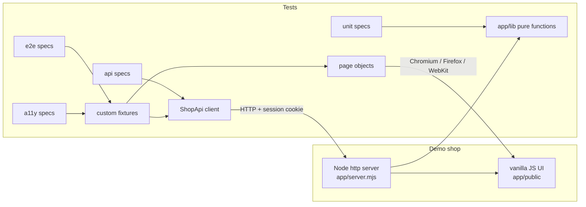

# Playwright E-Commerce Test Suite

A self-contained, end-to-end test framework built with **Playwright** and **TypeScript**. It ships with its own small demo shop, so `npm install && npm test` runs every test against a real application: no external site and no hidden backend.

The suite covers the test pyramid in one runner:

| Layer | Project(s) | Tests | What it proves |
| --- | --- | --- | --- |
| Unit | `unit` | 47 | Pricing, promo, card and form-validation rules in isolation |
| API | `api` | 77 | REST contract, status codes, sessions, security headers |
| End-to-end | `chromium`, `firefox`, `webkit` | 70 per engine | Real shopper journeys through the UI |
| Mobile smoke | `mobile-chrome`, `mobile-safari` | 10 per device | `@smoke`-tagged critical paths on Pixel 7 and iPhone 15 |
| Accessibility | `accessibility` | 8 | axe-core WCAG 2.2 A/AA scans plus keyboard checks |

That is 203 unique tests and 363 test runs per full execution.

## Quick start

Requires Node.js 20.12 or newer (Node 24 is used in CI; see `.nvmrc`).

```bash
npm install
npx playwright install          # add --with-deps on a fresh Linux machine
npm test                        # starts the demo shop automatically and runs every project
npm run report                  # open the HTML report
```

To use the shop yourself, run `npm start` and open <http://127.0.0.1:3100>.

## Scripts

| Command | Runs |
| --- | --- |
| `npm test` | Every project |
| `npm run test:unit` / `test:api` | Browser-free layers only (fast) |
| `npm run test:e2e` | Chromium, Firefox and WebKit |
| `npm run test:chromium` / `test:firefox` / `test:webkit` | One desktop engine |
| `npm run test:mobile` | Mobile smoke projects |
| `npm run test:a11y` | Accessibility scans |
| `npm run test:smoke` | Everything tagged `@smoke` |
| `npm run test:headed` / `test:debug` / `test:ui` | Watch, step through or explore tests |
| `npm run lint` / `typecheck` / `check` | ESLint (with `eslint-plugin-playwright`) and `tsc` |
| `npm run codegen` | Record locators against the running shop |

## Architecture



```
.
├── app/                         # System under test (zero runtime dependencies)
│   ├── server.mjs               # Routing, JSON API, static files, security headers
│   ├── lib/                     # pricing.mjs, validation.mjs (pure), store.mjs (in-memory state)
│   ├── data/catalog.mjs         # Deterministic 16-product catalogue
│   └── public/                  # index.html, app.js, styles.css
├── tests/
│   ├── unit/                    # Pure-function tests, no browser
│   ├── api/                     # Products, cart, auth, orders, HTTP hardening
│   ├── setup/auth.setup.ts      # Signs in once via API and saves storage state
│   ├── e2e/                     # products/, cart/, checkout/, auth/, account/
│   ├── a11y/                    # axe-core scans and keyboard checks
│   ├── pages/                   # Page Object Model (+ components/Header.ts)
│   ├── fixtures/                # index.ts (UI fixtures), api.ts (API fixtures)
│   └── support/                 # ShopApi client and response types
├── utils/                       # Test data builders, money helpers, paths
├── playwright.config.ts
└── .github/workflows/playwright.yml
```

## Design decisions

**The application is part of the repository.** Tests that depend on an app nobody can run are documentation, not tests. The demo shop is about 2,000 lines of dependency-free Node and vanilla JavaScript, and Playwright's `webServer` starts it automatically.

**Every test is isolated by its session.** The shop keeps carts per session cookie, and every Playwright browser context or `request` context has its own cookie jar. Parallel workers never share a cart, so there is no global reset endpoint and no ordering between tests.

**State is seeded through the API, not clicked into place.** The `shopApi` fixture wraps `page.request`, which shares cookies with the browser context. A checkout test calls `shopApi.seedCart(...)` and opens `/checkout` directly; adding to the cart through the UI has its own dedicated tests.

```ts
test('express shipping updates the order summary', async ({ shopApi, checkoutPage }) => {
  await shopApi.seedCart({ productId: PRODUCTS.tee.id, size: 'M' });
  await checkoutPage.goto();
  await checkoutPage.shippingOption('express').check();
  await expect(checkoutPage.total).toHaveText('$41.98');
});
```

**Authentication is reused where it is safe.** The `setup` project signs in through the API once and saves `playwright/.auth/demo-user.json`. Only read-only account tests reuse it with `test.use({ storageState })`. Tests that change account state use the `newUser` fixture, which registers a fresh user inside the test's own context.

**Locators and assertions follow what users perceive.** Page objects prefer `getByRole` and `getByLabel`, fall back to `data-testid` for values such as totals, and every check is a web-first assertion that retries. Form errors are verified with `toHaveAccessibleDescription`, which proves the message is both visible and announced to assistive technology.

**Uncaught page errors fail the test.** An auto fixture listens for `pageerror` and fails any test whose page threw, even when all its assertions passed.

**Exact expectations.** API tests assert one status code and the full error body (for example `expect(status).toBe(409)`), never "any of 200/401/404". Prices are integer cents, and totals are checked to the cent.

**Data-driven cases.** Validation rules, payment declines, promo codes, unsafe redirect targets and sort orders are tables that generate one clearly named test per row.

## Demo shop reference

| Item | Value |
| --- | --- |
| Seeded account | `shopper@example.test` / `Shopper#2026` |
| Successful card | `4242 4242 4242 4242`, any future expiry, any 3-digit CVC |
| Declined cards | `4000 0000 0000 0002` (declined), `4000 0000 0000 9995` (insufficient funds) |
| Promo codes | `SAVE10` (10% off), `FREESHIP` (free shipping), `SPRING2025` (expired) |
| Pricing | 8% tax on the discounted subtotal; standard shipping $5.99 or free from $75; express $14.99 |
| Out-of-stock product | Rain Shell Jacket |

All state is in memory and resets when the server restarts. Orders never decrement stock, so parallel tests cannot exhaust a product.

## Configuration

Copy `.env.example` to `.env` to override defaults:

- `PORT`: port for the demo shop (default `3100`).
- `BASE_URL`: run against an already-running deployment; the local server is then not started.
- `DEMO_USER_EMAIL` / `DEMO_USER_PASSWORD`: seeded account, read by both the server and the tests.

CI enables `forbidOnly`, two retries, traces on the first retry, and GitHub, JUnit and HTML reporters.

## Continuous integration

`.github/workflows/playwright.yml` runs on pushes to `main`, pull requests, manual dispatch and weekday mornings:

1. **checks**: lint, typecheck, then the unit and API projects (no browser download needed).
2. **e2e** (after checks pass): a matrix of Chromium + accessibility, Firefox, WebKit, and mobile. Each job installs only the browsers it needs and uploads its HTML report and traces.

## Adding a test

1. If the page is new, add a page object in `tests/pages/` that extends `BasePage`, and register it in `tests/fixtures/index.ts`.
2. Seed preconditions with `shopApi`, and drive only the behaviour under test through the UI.
3. Use role or label locators and web-first assertions. Tag critical journeys with `{ tag: '@smoke' }` so they also run on mobile.
4. Run `npm run check` and the affected project before opening a pull request.

## Acknowledgements

Inspired by the structure of [SabaTskhelishvili/playwright-ecommerce-test-suite](https://github.com/SabaTskhelishvili/playwright-ecommerce-test-suite) (page objects, fixtures, multi-browser projects and CI), extended with a runnable system under test, API seeding, accessibility checks and strict assertions.
